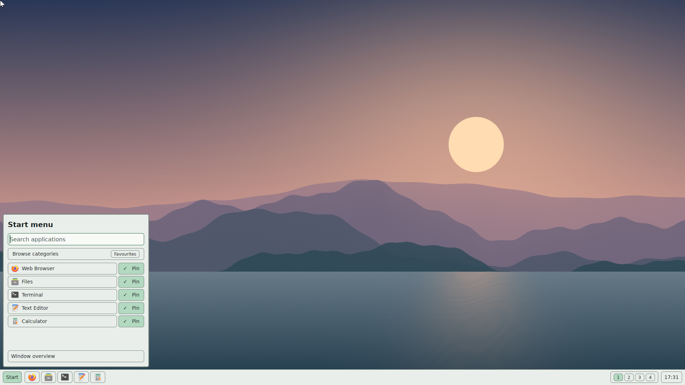
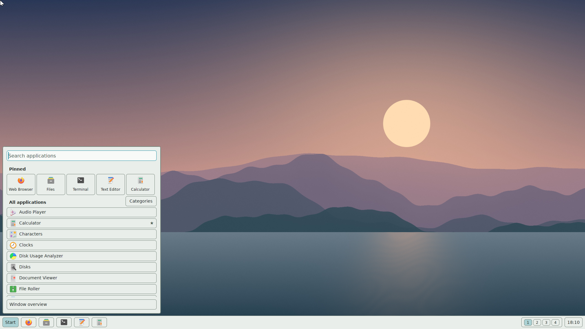

# GPUI Start and Quick Settings

Both Start captures are full 1920×1080 scanouts from a headless joe Linux beta1 guest, with the same desktop entries and five favourites in the same order. The reviewed step 1 checkout was `3a379b5`, and the step 2 shell was built from `9fb89d6`. The taskbar stays visible in each image.

| Start before, reviewed step 1 | Start after, step 2 |
| --- | --- |
|  |  |

Right-clicking Files opens its [application actions](application-actions.png). The Menu key and a held primary click open the same menu. The star beside Calculator in the application list shows that it is pinned. A separate [taskbar capture](running-taskbar.png) shows Text Editor running in the background and Calculator active.

| Appearance | Start | Quick Settings |
| --- | --- | --- |
| Light | [Pinned grid and full list](after-start.png) | [Virtual Wi-Fi and audio output](quick-settings.png) |
| Dark | [Start](dark-start.png) | [Quick Settings](dark-quick.png) |
| High contrast | [Start](contrast-start.png) | [Quick Settings](contrast-quick.png) |

[Quick Settings at 200% output scale](scaled-quick-settings.png) shows the same physical display at 960×540 logical pixels.
