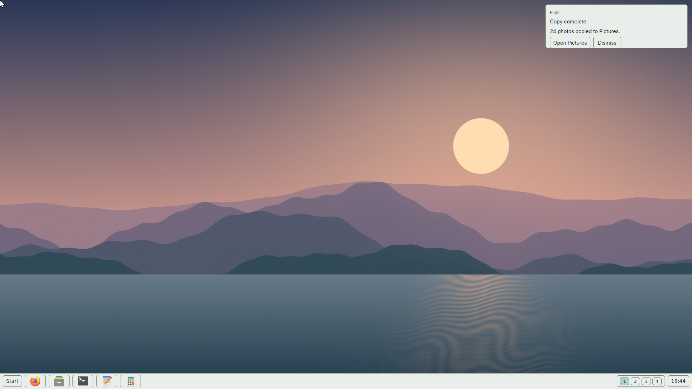
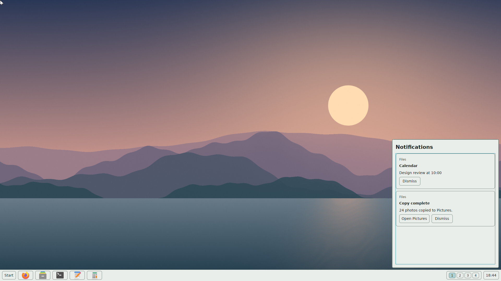
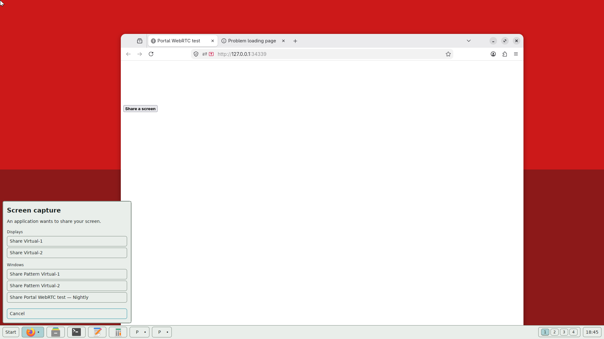
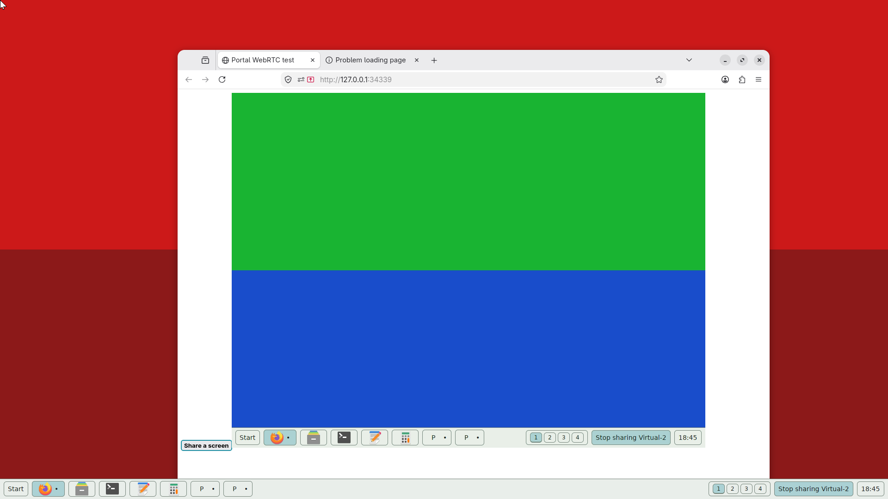
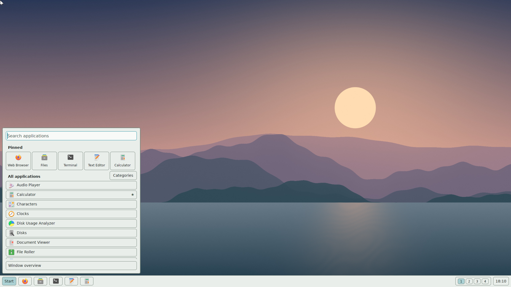
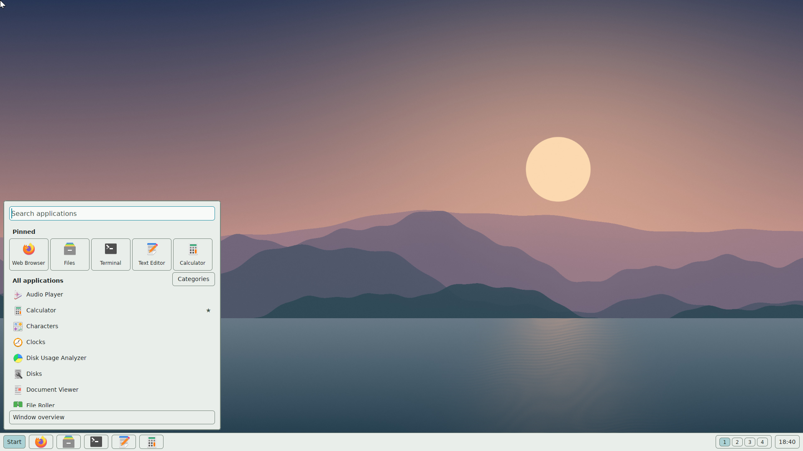

# GPUI notifications, sharing and Start

These 1920×1080 images are full QMP scanouts from a headless joe Linux beta1 guest running the step 3 release build at `3a66c87`.

| Notification banner | Notification history |
| --- | --- |
|  |  |

The same live Files banner in [dark appearance](dark-notification.png) and [high contrast](contrast-notification.png). A [volume key while typing](volume-osd.png) leaves the orange test window focused. The [automatic fallback notice](upgrade-fallback.png) names deployments 5 and 4 from the dave fixture.

| Firefox requests a source | Firefox receives the selected display |
| --- | --- |
|  |  |

The red bands are on the primary monitor behind Firefox. The green and blue bands are on Virtual-2. Its taskbar also carries the sharing control. A [screenshot request](screenshot-consent.png) offers a one-time choice of display or window.

| Step 2 launcher | Step 3 launcher |
| --- | --- |
|  |  |

The [running taskbar](running-taskbar.png) uses the same shared 32-pixel icon slots as the pinned grid. Start’s search results and application list use mundane-ui’s flat row.
