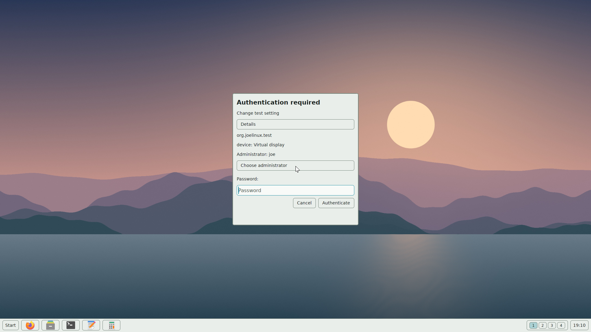
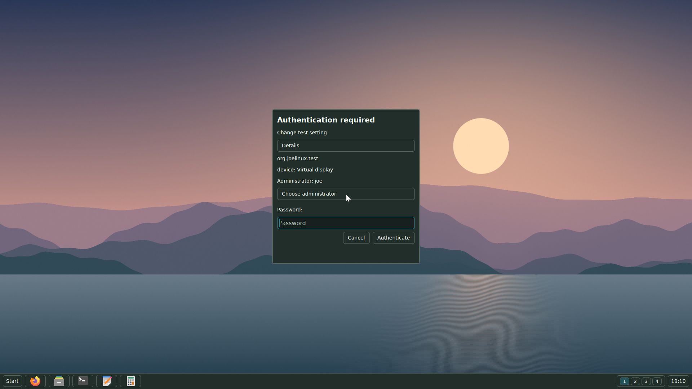
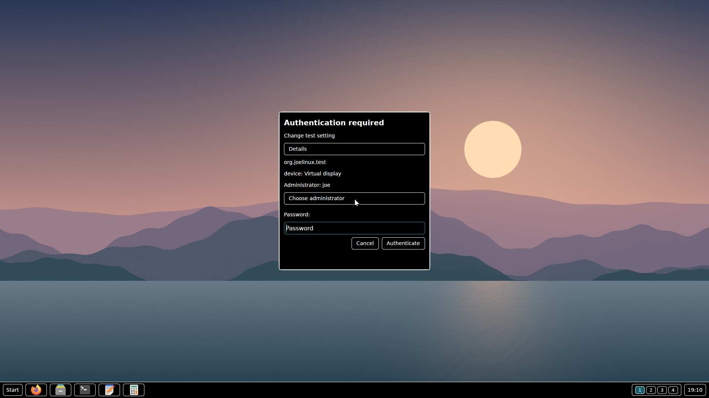

# GPUI authentication dialog

These full 1920×1080 QMP scanouts show the release shell at `3f63784` on a headless joe beta1 guest. The private test authority offered two administrators. The operator selected joe, expanded the action details and changed the live appearance with the password field empty.

| Light | Dark | High contrast |
| --- | --- | --- |
|  |  |  |
