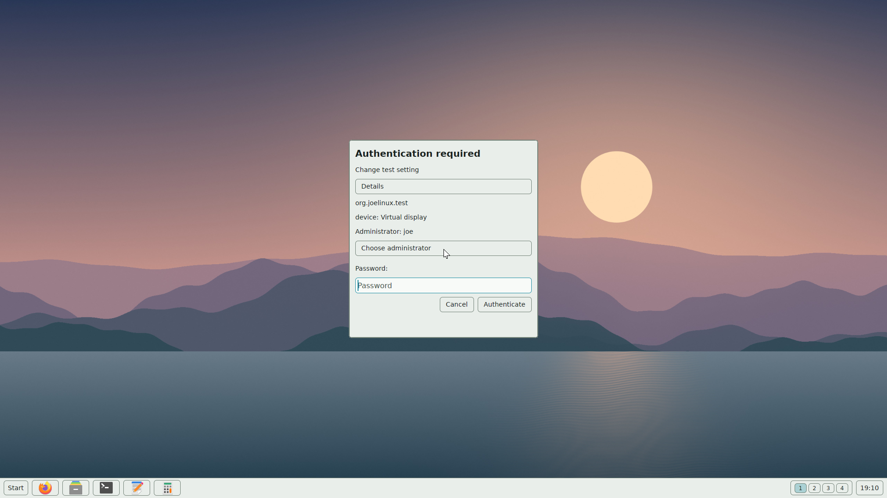
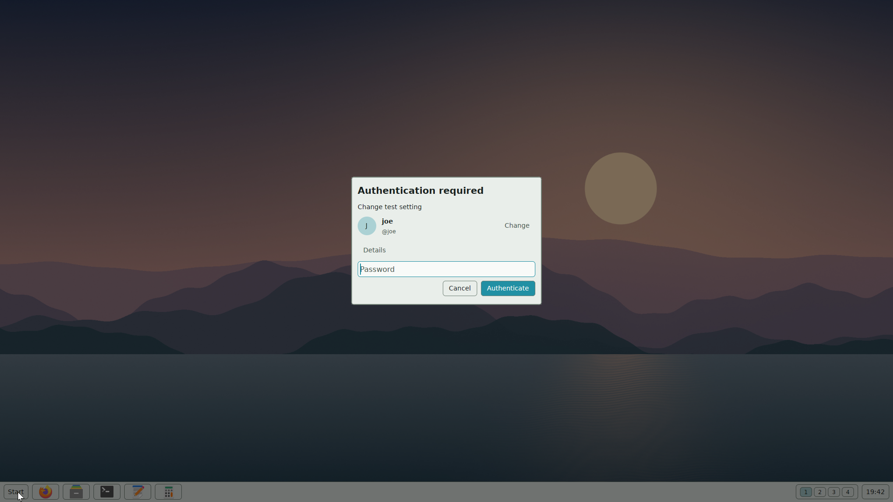
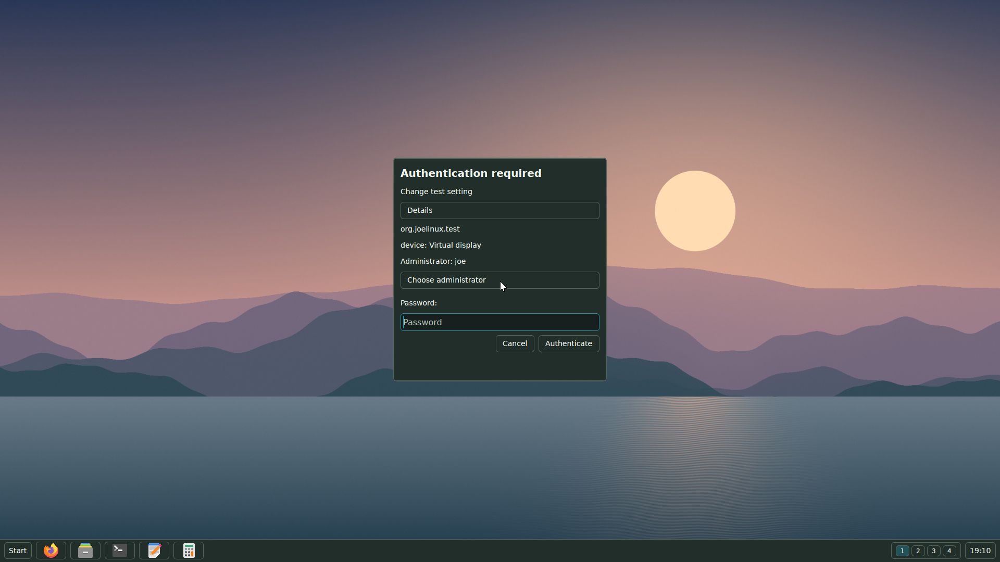
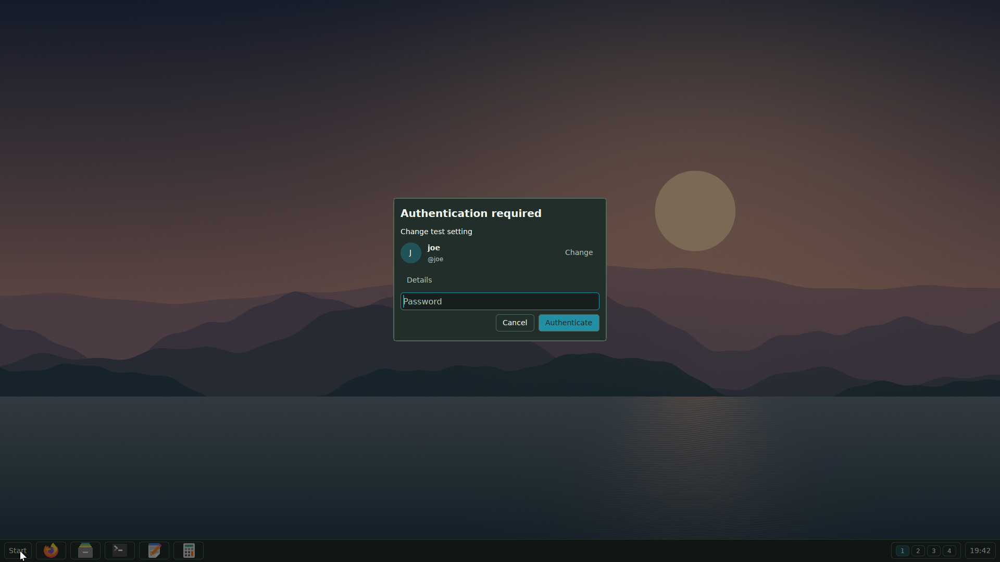
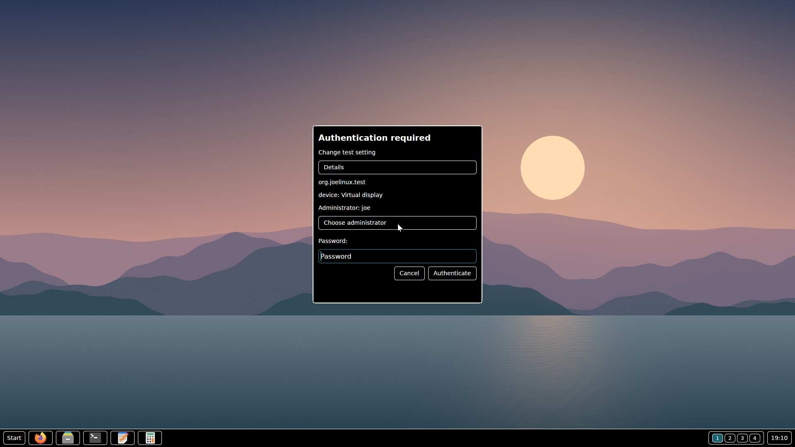
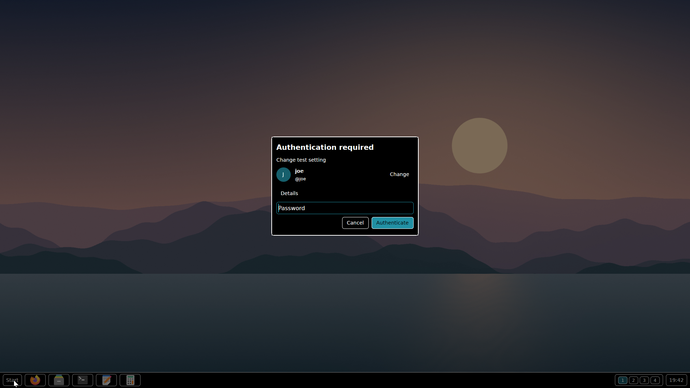
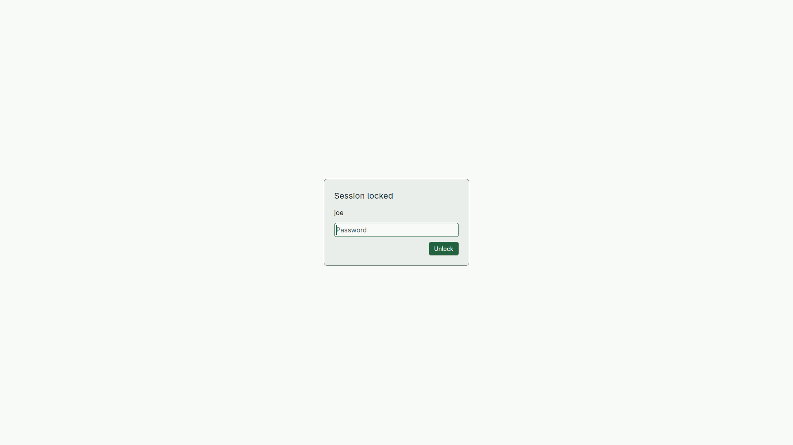
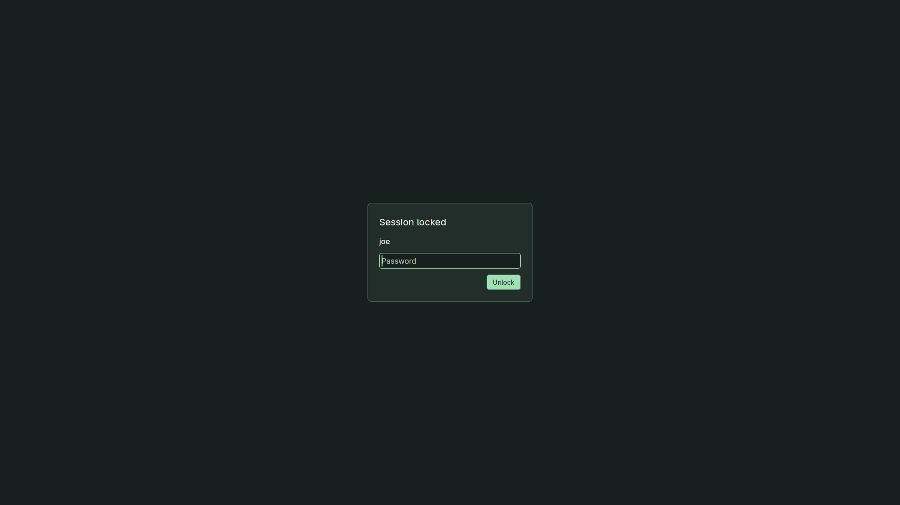
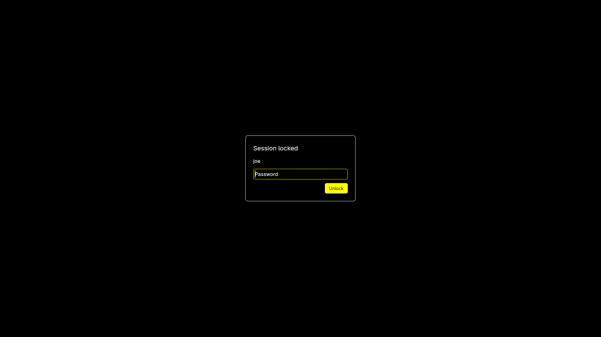

# Authentication before and after

Each image is a full 1920×1080 QMP scanout from a headless joe beta1 guest. In both versions the authority offered two administrators and the operator selected joe. The earlier captures show the action details. The new captures show the default collapsed state and the desktop dimmed behind the prompt.

| Appearance | Step 4 | Redesigned prompt |
| --- | --- | --- |
| Light |  |  |
| Dark |  |  |
| High contrast |  |  |

## GPUI lock

| Light | Dark | High contrast |
| --- | --- | --- |
|  |  |  |

The guest exercised an incorrect password with Orca listening. [Inline PAM denial](denied.png)
