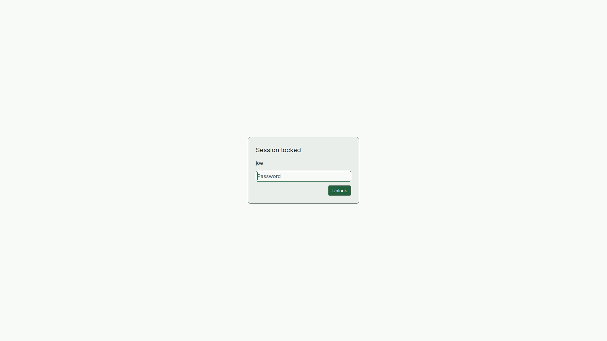
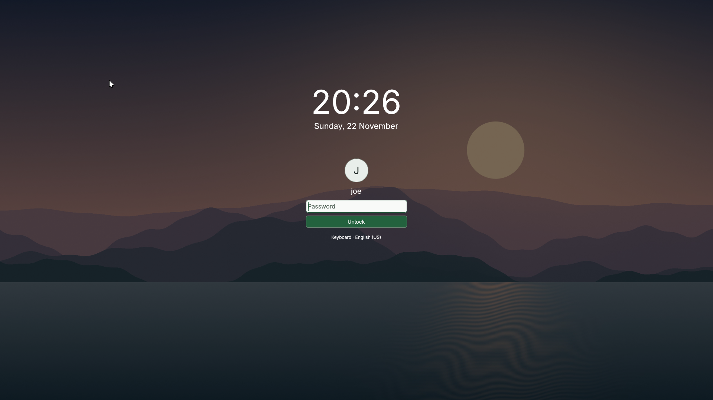
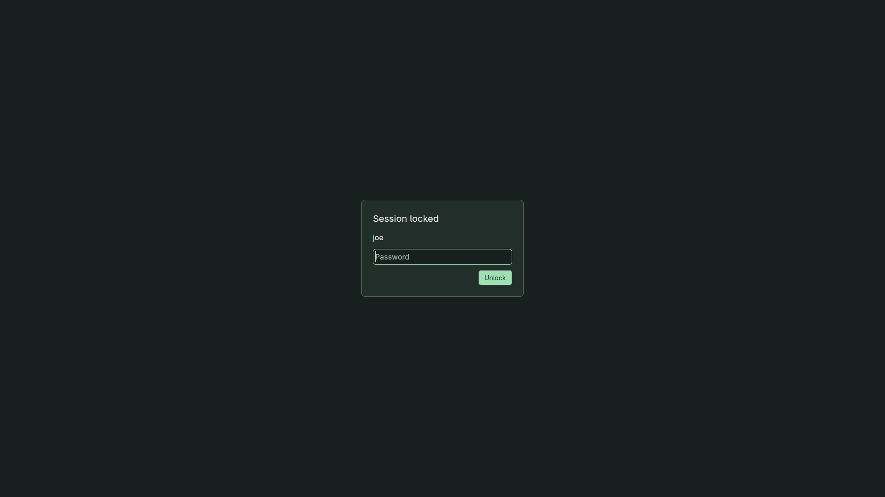
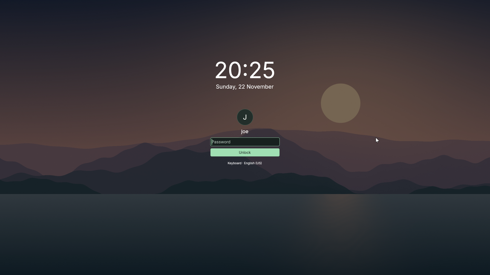
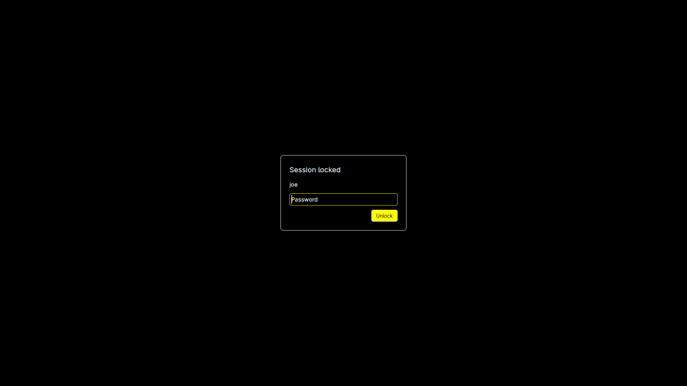
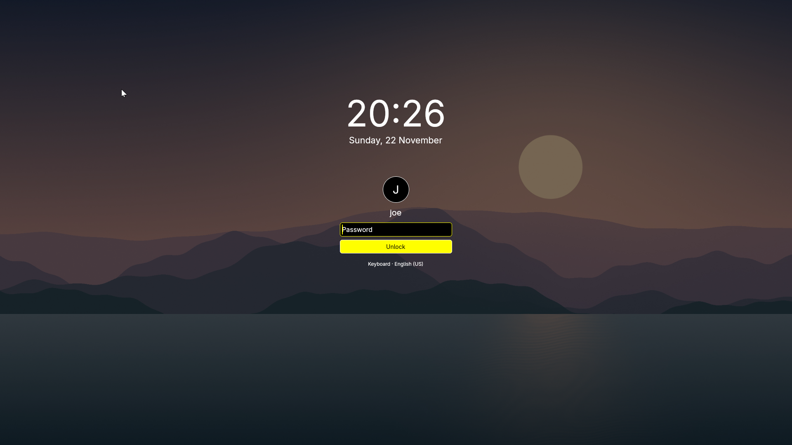
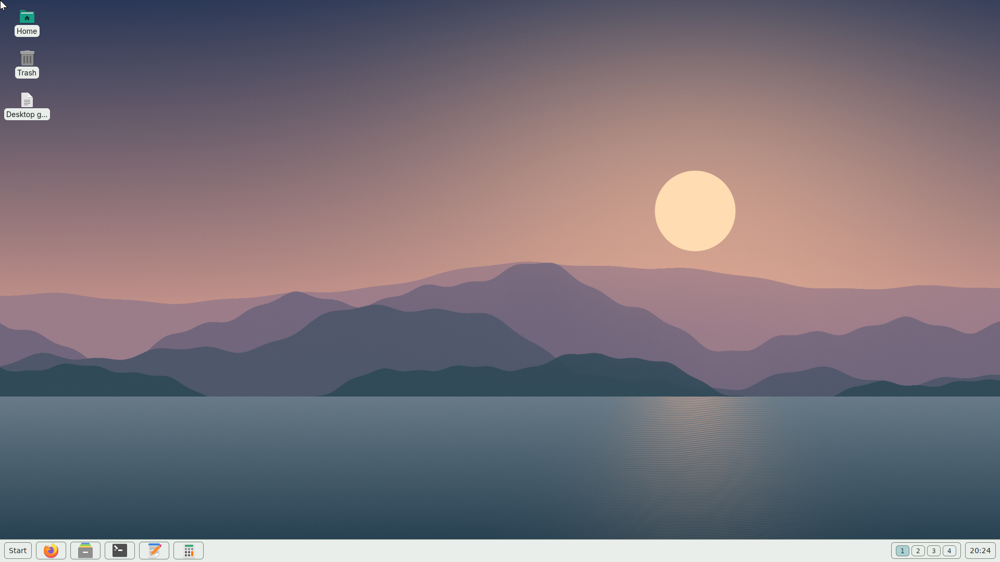
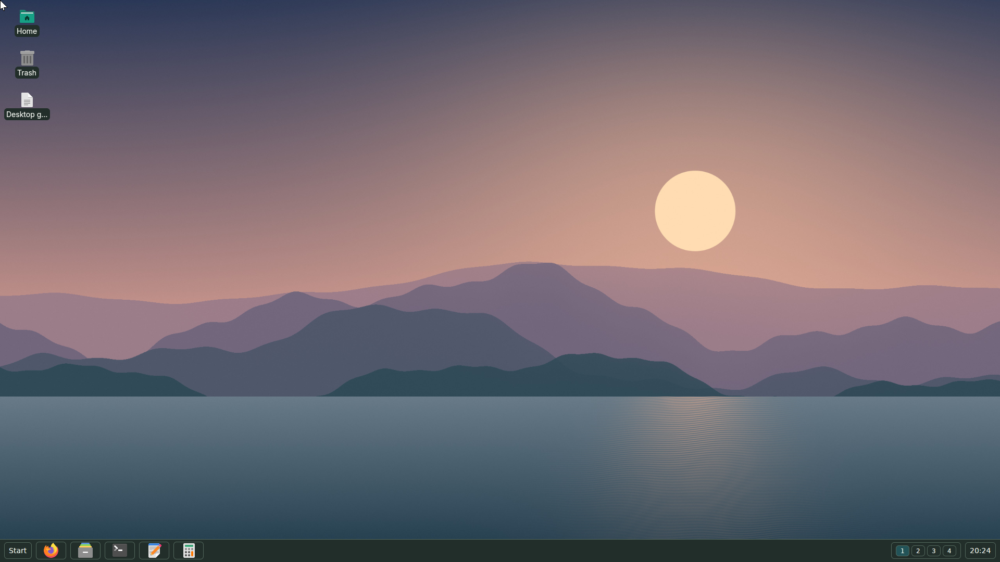
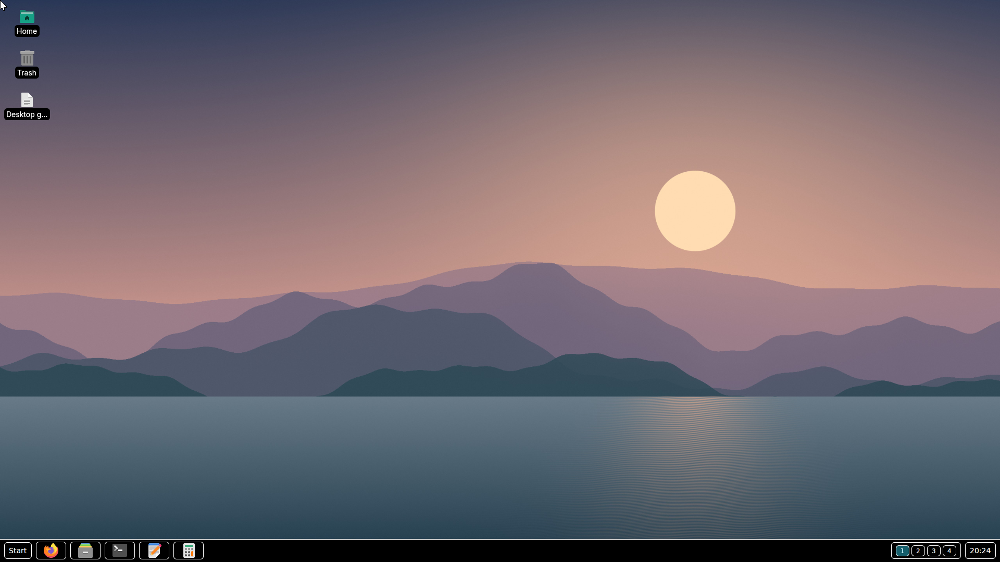

# Lock screen before and after

Full-resolution 1920×1080 scanouts from the headless joe beta1 guest. The guest used Afterlight as its current wallpaper. The prompt followed the pointer to the second display during the test.

| Appearance | Step 5 | Redesigned lock screen |
| --- | --- | --- |
| Light |  |  |
| Dark |  |  |
| High contrast |  |  |

[Clock after 30 seconds of inactivity](clock.png)

## Desktop icons and dialogs

| Desktop in light appearance | Dark appearance | High contrast |
| --- | --- | --- |
|  |  |  |

[File chooser with an active filter](open-file.png) · [Application chooser](open-with.png) · [Japanese candidates at the GTK caret](input-method.png)
