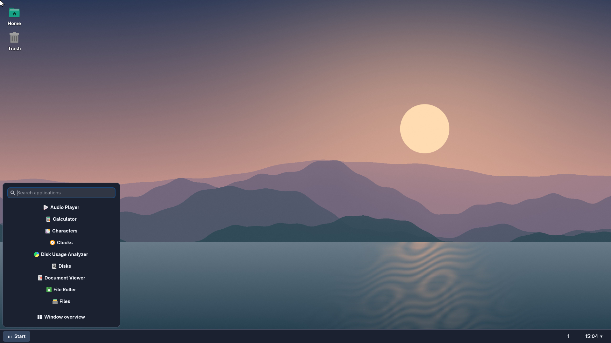
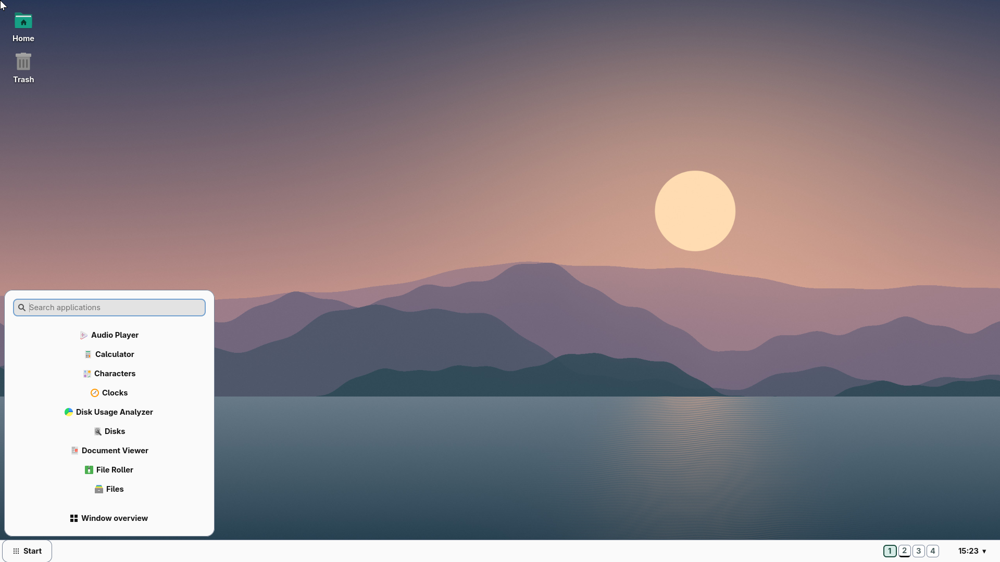
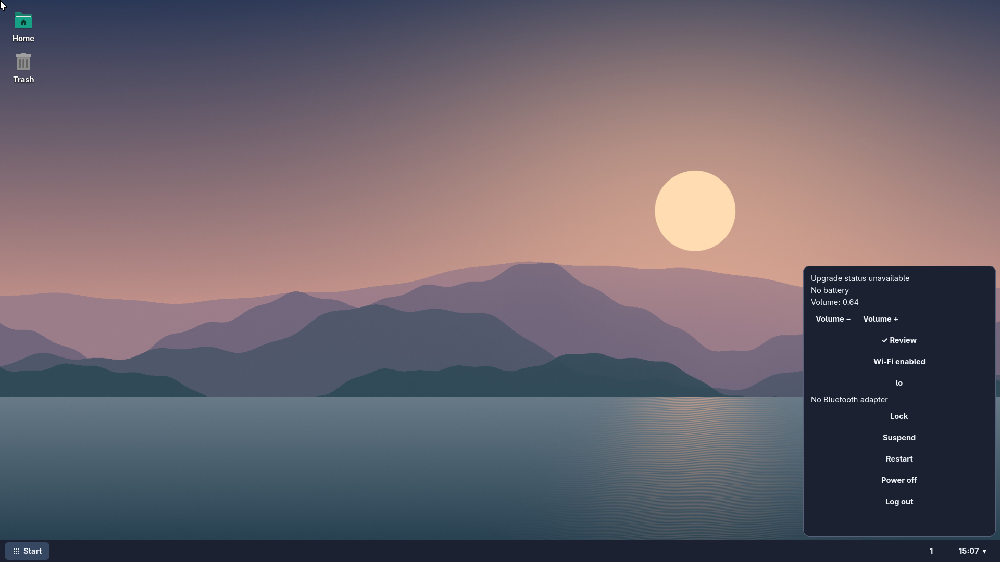
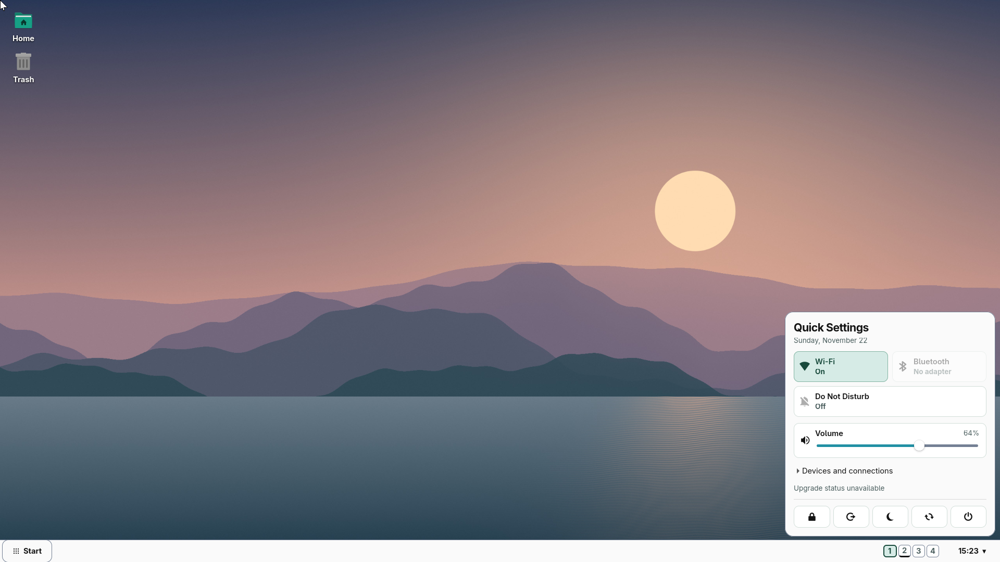
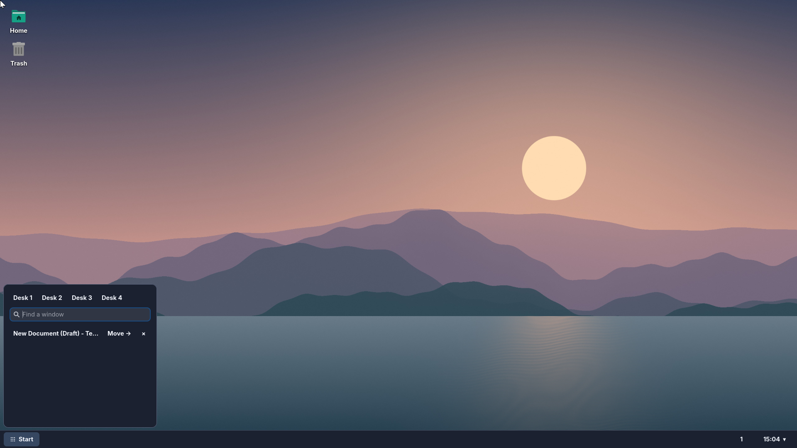
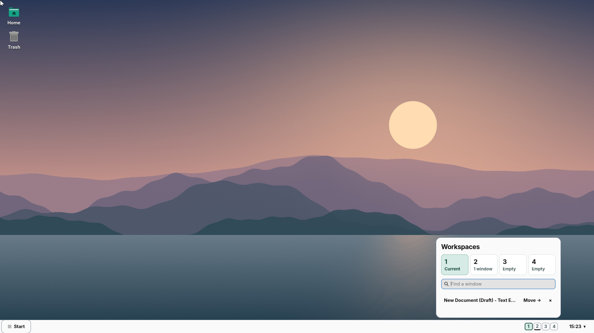

# First hand-test retest

These full-resolution screens come from a headless joe Linux beta1 guest at
1920×1080. Workspace 1 is clear and Text Editor is open on workspace 2.
Select a thumbnail to inspect the original PNG.

| Hand-test finding | Before · `5332dbc` | After |
| --- | --- | --- |
| Start and menu dismissal |  |  |
| Clock and system controls |  |  |
| Switching workspaces |  |  |

Quick Settings also has a [high-contrast view with keyboard focus](after-high-contrast.png).

The screenshots show each menu open. The [headless test](../../../tests/qemu/session/qualify_menus.py)
drives the second click, Escape and outside click and checks where the next
keystroke goes. The [hand-test checklist](../../manual-test.md#retest-the-first-hand-test-findings)
tracks the maintainer’s retest.
